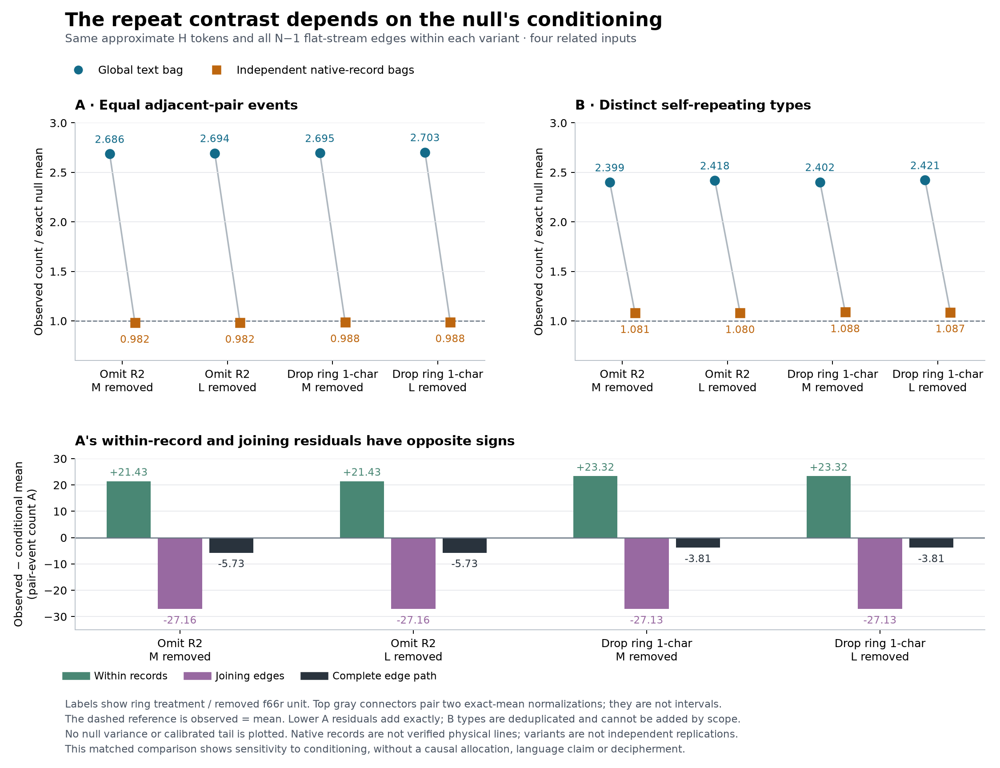

# Matched H inputs, changed null conditioning



This figure displays the accepted [global study](../REPEATED_TYPES.md) and
[native-record-conditioned study](../RECORD_CONDITIONED.md). Each plotted
variant uses identical approximate H tokens and all N−1 surviving flat-stream
edges under both nulls, including native-record joins and normalized index-gap
edges. The four variants are related, exposed input reconstructions.

## Reading the panels

The upper panels keep two distinct units separate: A counts all equal adjacent
pair events, including overlaps; B counts distinct complete types with at least
one such repeat. Blue circles normalize the observed count by its exact mean
under a global text bag; orange squares use independent native-record bags.
Gray connectors pair those two normalizations for the same observation and
input. They are not uncertainty intervals. The dashed reference is ratio=1.

A's global ratios are 2.686–2.703 and its conditioned ratios are 0.982–0.988.
B's corresponding ratios are 2.399–2.421 and 1.080–1.088. These are ratios to
exact rational means, not sampled-control means or tail probabilities. The
figure shows the mean contrast's sensitivity to conditioning, without allocating
a causal contribution or evaluating a language/cipher mechanism.

The lower panel separates A's conditioned residual into within-record events
and joining events, plus their exact total. Positive within-record residuals
of 21.43/23.32 coexist with negative joining residuals of −27.16/−27.13,
producing total residuals of −5.73/−3.81. The display rounds values; the producer
checks additivity using exact source rationals before plotting. It does not
apply this additive decomposition to B, whose types overlap across scopes.

Labels identify the ring treatment and removed f66r unit. Both ring choices
and both M/L exclusions are retained; none is selected as a preferred edition.
No confidence intervals, null variance, sampled controls, significance threshold
or calibrated tail are added. Native records are not verified physical lines,
and the variants are not independent manuscript replications.

## Source identity and complete companion

The renderer requires these exact accepted report bytes:

| Study | Report SHA-256 |
| --- | --- |
| Global | `683a0906eaf01dbacf5394eb0ded820802df0f09c293302a452351494338dc2a` |
| Native-record conditioned | `56fc5f036627cffbf3f597090fbafd22afe102c2430f6f606c4f1d46c5b17b1b` |

The [JSON companion](repeat-null-conditioning.json) retains all four plotted
case identities, token/type/edge denominators, both record/flat input digests,
observed A/B, both exact means as display decimals, all sixteen ratios, twelve
scope residuals, source credits/permissions and renderer identity. Full exact
hexadecimal rationals remain in the two accepted input reports. No corpus is
reparsed and no new shuffle or exclusion is performed by the figure renderer.

The producer checks complete variant order, matched corpus hashes and observed
diagnostics, explicit null frames, exact rational/decimal consistency, all
reported normalizations, overlapping type accounting and exact A-scope
additivity. Changed report bytes fail before rendering; any new accepted report
version requires an explicit figure update and review.

## Reproduce and validation

Seven focused tests cover retained treatments/units, missing or duplicate
variants, input/edge/null mismatch, exact mean/ratio/residual drift, changed-byte
failure preservation and direct/symlink/hardlink input or cross-artifact aliases,
including aliases introduced after the initial check. The transformation tests
use the standard library and require no plotting dependency.

PNG and [SVG](repeat-null-conditioning.svg) exports use the repository's pinned
`requirements-figures.txt`: Matplotlib 3.11.2 and DejaVu Sans. SVG dates are
omitted, glyph IDs use a fixed salt, and PNG export uses 180 dpi. All three
artifacts regenerate byte for byte in that environment. The PNG was visually
checked for readable titles, labels, legends and captions without overlaps.

From the repository root:

```sh
python3 -m venv /tmp/voynich-figure-env
/tmp/voynich-figure-env/bin/pip install -r requirements-figures.txt
MPLCONFIGDIR=/tmp/voynich-historical-repeat-mpl /tmp/voynich-figure-env/bin/python scripts/plot_historical_repeat_nulls.py
python3 -m unittest tests.test_historical_repeat_figure -v
```

Rendering finishes in memory before guarded writes. Reports, their frozen
dependencies, registered plans, helpers and the renderer are protected against
output aliases; artifact paths are rechecked before each write. This does not
claim an atomic filesystem transaction. Raw source payloads and manuscript
images are not included in the figure exports.

The original input/parser/count/label discrepancies and exposure remain
unresolved. This is a faithful display of accepted exploratory comparisons,
not a historical-author replication, original-script recovery, glyph reading,
language identification, decipherment or translation.
