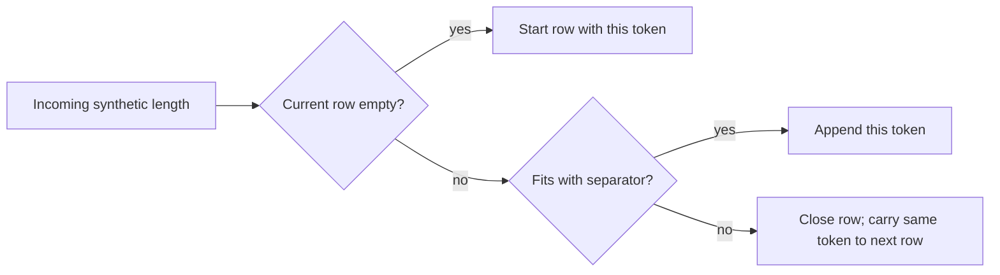

# Synthetic wrapping can create an initial-length contrast

This declared IID-length plus greedy-wrapping process induces a positive
equal-row initial-minus-rest contrast in four of its five cases, while the
capacity-7 calibration has exact expectation zero. A departure from a
within-row permutation control alone therefore does not identify a
position-dependent encoding mechanism. This is a synthetic counterexample,
not a fitted explanation of the manuscript.

## Mechanism and weighting

Incoming token lengths are uniform over a fixed support. Append a token if it
fits with one separator unit; otherwise close the row and carry that same
token unchanged into the next row. A token that failed to fit is selected as
the next first token. It is **not redrawn** from the incoming law at a boundary.
Lengths and token order are preserved; no special prefix or encoding is added.



Each completed row gets one vote: its first length minus the mean of its other
lengths. This is not token-weighted averaging. All configured capacities
guarantee at least two tokens per overflow-closed row. The final unclosed row
is excluded even when it exactly fills the capacity. Its lengths are recorded.

The [protocol](PROTOCOL.md) and [complete settings](parameters.json) were
committed in `f96e80b`, with the recurrent-class requirement clarified in
`f223eef`, before the sweep and simulation outputs. The experiment was selected
after the exposed manuscript baseline. Capacities 7 and 8 are **previously
derived calibration checks**, not prospective discoveries.

## All five outcomes

Exact values are stationary expectations over completed-row boundaries.
Finite samples retain the first completed row, including the initial transient,
and use 100,000 deterministic lengths per law. The same stream is reused across
capacities of the same law. The discrepancy is descriptive; no fitted
tolerance, confidence interval, or generative significance test is applied.

| Uniform synthetic support | Capacity | Exact stationary contrast | Finite contrast | Completed rows | Finite minus exact |
| --- | ---: | ---: | ---: | ---: | ---: |
| 2, 3 — known zero calibration | 7 | 0 | +0.003580 | 49,999 | +0.003580 |
| 2, 3 — known positive calibration | 8 | 1/18 = +0.055556 | +0.056124 | 47,306 | +0.000568 |
| 2, 3, 4, 5, 6 | 18 | +0.391509 | +0.392806 | 29,720 | +0.001297 |
| 2, 3, 4, 5, 6 | 24 | +0.397487 | +0.407702 | 21,924 | +0.010215 |
| 2, 3, 4, 5, 6 | 30 | +0.399203 | +0.395064 | 17,342 | −0.004139 |

Do not treat the approximately 0.39–0.40 toy magnitude as a fitted match to
manuscript ASCII/EVA effects. The synthetic units, incoming length law, row
occupancy, and geometry are unrelated to measured manuscript glyph widths or
reviewed physical lines. No manuscript input was used here.

## Exact finite calibration

For uniform lengths 2 and 3 at capacity 8, enumerate every fitting path until
overflow. Rows beginning with 2 have conditional mean contrast −1/2; rows
beginning with 3 have +1/2. The boundary kernel retains the rejected length:

| Current first length | Next first length 2 | Next first length 3 |
| --- | ---: | ---: |
| 2 | 3/8 | 5/8 |
| 3 | 1/2 | 1/2 |

Its stationary start law is `[4/9, 5/9]`, giving
`(4/9)(−1/2) + (5/9)(+1/2) = 1/18`.
The incoming law remains `[1/2, 1/2]`; unequal row-start probabilities arise
from carry selection. At capacity 7 every complete row contains exactly two
tokens, and its exact expected contrast is zero. Wrapping does not guarantee a
positive effect at every capacity.

All five computed kernels have one closed communicating class with full
first-length support and a positive recurrent self-transition. Every row sum,
stationary probability normalization, support, and stationarity equation checks
exactly with rational arithmetic. The
[complete JSON](results.json) contains every kernel, conditional reward,
stationary probability, row-token-count law, exact contrast fraction, stream
digest, finite count ledger, discarded final row, and code/input fingerprint.

## All six fixed-count controls

Divide each same incoming stream into complete chunks of 3, 4 or 5 tokens.
These are separate control definitions with different occupancy, not matched
row geometry. Every IID fixed-count chunk has exact expected contrast zero.
The finite outcomes, including both signs, are retained:

| Uniform support | Chunk size | Exact IID expectation | Finite contrast |
| --- | ---: | ---: | ---: |
| 2, 3 | 3 | 0 | −0.000780 |
| 2, 3 | 4 | 0 | +0.003533 |
| 2, 3 | 5 | 0 | +0.000413 |
| 2, 3, 4, 5, 6 | 3 | 0 | +0.009450 |
| 2, 3, 4, 5, 6 | 4 | 0 | −0.008947 |
| 2, 3, 4, 5, 6 | 5 | 0 | +0.000763 |

The JSON also reports the exact-formula conditional standard deviation of
uniform first-token selection within every finite row bag. That control has
zero equal-row expectation. It holds existing rows fixed and chooses positions
independently; its variance is **not** the sampling variance of the dependent
greedy-wrapping rows and is not used for a generative significance claim.

## Reproduction and validation

```sh
python3 scripts/greedy_wrap_control.py --check research/line-wrap/results.json
python3 -m unittest discover -s tests -p 'test_greedy_wrap_control.py' -v
```

Ten focused tests pass. Independent recursive enumeration of actual token
paths agrees with the occupancy-state kernel and rewards for two-length
capacities 7, 8 and 9. The capacity-9 enumeration is an implementation check,
not a sixth declared analysis case. After observing the first sweep, an added
implementation check enumerated the five-length law at capacity 13; it checks
kernel/reward accounting, not a stationary or simulated outcome, and does not
enlarge the declared sweep. This later check is validation, not prospective
evidence. Both calibration expectations, fixed-count zero expectations, carried
token conservation, equality-fit/final-row behavior, negative finite scores,
equal-row weighting, and unsupported recurrent-class/settings failures are
tested. The complete report reproduces, including stream hashes and all
implementation fingerprints.

A collaborating reviewer reproduced the complete report and checked the
kernel/reward/stationary calculations. The review also reproduced a hardlink
output alias overwriting a temporary copy of an input; path resolution alone
did not detect that alias. The writer now rejects protected inode aliases
before computation and writing. A CLI regression uses only a temporary input
copy and confirms failure without changing either linked file. Numeric outputs
remain identical after the fix; only implementation provenance changes.

## Source context and next manuscript test

[Reddy and Knight (2011)](https://aclanthology.org/W11-1511/), section 6.2 and
Figure 7, compare line-edge character distributions with within-line word
shuffles. This artifact supplies a different synthetic length/layout control;
it does not reproduce their statistic or corpus and does not attribute this
mechanism to that paper.

To test layout against the manuscript, first establish reviewed physical-line
and image/transcription correspondences. Freeze width, spacing, boundary and
missing-material rules before fitting or evaluation, retain paragraph and
drawing effects, and use material excluded from fitting. A native locus is not
automatically a physical row. This toy alone provides no glyph mapping,
language identification, decipherment or translation.
