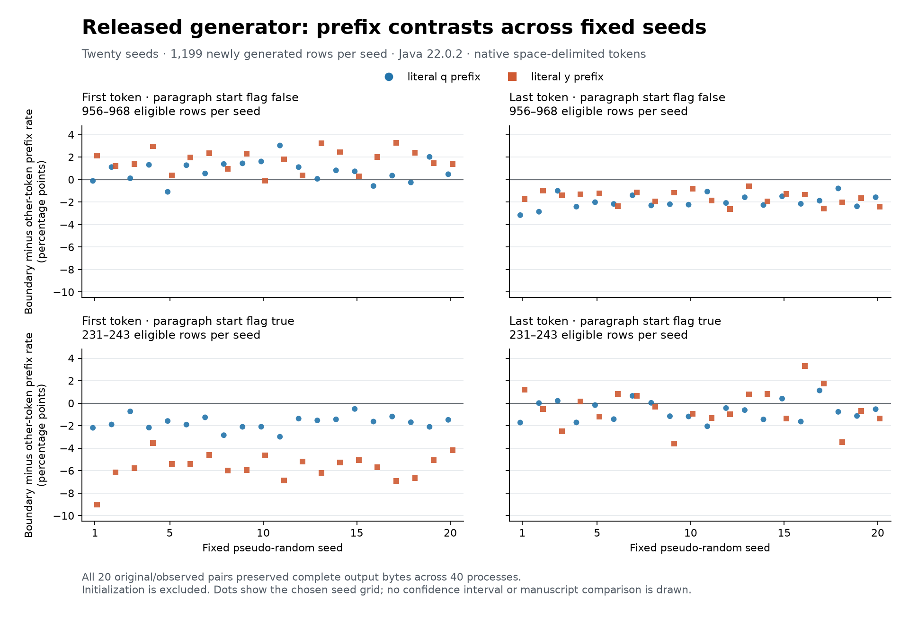

# Native generator prefix effects over twenty fixed seeds

The released configuration produces both persistent context patterns and seed
variation. First-boundary q/y contrasts in model paragraph-initial rows, and
last-boundary q/y contrasts in other model rows, are negative in all 20 cases.
The other four cells change sign across the grid. This is a description of
generated output under fixed settings, not a manuscript goodness-of-fit result
or a decipherment.

The [plan](SELF_CITATION_PREFIX_SEED_PLAN.md) fixed seeds 1–20 and all eight
measurements before the new full-grid execution. The source, complete seed-19
output and short seed-20 output were already exposed. The
[complete census](self-citation-prefix-seeds.json) retains all 160 cells,
every case, process/build outcome, eligibility count and artifact fingerprint.
No parameter or seed was selected from these effects.

## Program, controls and units

Use the same pinned author release, executable property file, Java 22.0.2,
compiler settings and reviewed environment controls as the
[source-build replay](SELF_CITATION_REPLAY.md). Build the original and
[observed](SELF_CITATION_ROW_TRACE.md) programs once each and verify their
compiled inventories against the recorded controls. For each integer seed from
1 through 20, run one fresh original JVM and one fresh observed JVM with 1,200
saved rows. Change only the declared seed and save properties.

All **40 processes** exited zero and all **20 pairs** preserved their complete
output bytes. Every observed case supplied the complete ordered 1,199 call
events and a 1,200-row ledger. Seed 19 also reproduced the supplied release
artifact. The original source checkout remained unchanged. Generated text,
third-party/instrumented source, classes, raw configurations, logs and ledgers
remain local; fingerprints and original measurements are committed.

Exclude the one reused initialization row in each case. No newly generated
row had fewer than two tokens in this grid, so all 1,199 generated rows per
seed were eligible. The common first/last/q/y eligibility set is partitioned
only by the observed paragraph-initial call flag. Non-initial groups contain
956–968 rows per seed; initial groups contain 231–243. These are program flags
and native output rows, not manuscript annotations or physical/glyph units.

The measure shares the accepted exact binary-prefix
[`locus_moments`](../../scripts/prefix_conditional_bounds.py) definition. For
each eligible row, use the boundary indicator minus the average of all other
token indicators, then average those contrasts with equal row weights. Tokens
are the native single-space-delimited strings; the prefixes are literal ASCII
q/y. Keep exact rational means, boundary-positive counts, average other-token
rates and every denominator. No token is promoted or selected from its value.

## All eight descriptive summaries

Values below are percentage points, rounded for display. The mean averages
the 20 seed-specific row means, giving seeds equal weight. Ranges and sign
counts describe this deterministic schedule; they are not confidence intervals,
p-values or estimates of an independently sampled seed population.

| Model paragraph-initial flag | Boundary | Prefix | Mean | Minimum | Maximum | Negative / zero / positive seeds |
| --- | --- | --- | ---: | ---: | ---: | --- |
| false | first | q | +0.7690 | -1.0899 | +3.0321 | 4 / 0 / 16 |
| false | first | y | +1.7037 | -0.1018 | +3.2821 | 1 / 0 / 19 |
| false | last | q | -1.9490 | -3.1631 | -0.7867 | 20 / 0 / 0 |
| false | last | y | -1.6227 | -2.6397 | -0.5857 | 20 / 0 / 0 |
| true | first | q | -1.7347 | -2.9840 | -0.5095 | 20 / 0 / 0 |
| true | first | y | -5.6774 | -9.0119 | -3.5448 | 20 / 0 / 0 |
| true | last | q | -0.6761 | -2.0523 | +1.1309 | 14 / 0 / 6 |
| true | last | y | -0.4400 | -3.6035 | +3.2879 | 12 / 0 / 8 |



The [SVG](figures/self-citation-prefix-seeds.svg) supports export and the
[figure-data sidecar](figures/self-citation-prefix-seeds.json) retains all 160
points, exact means, eligibility counts, the census byte hash and renderer
identity. Dots display individual seeds; no smoothing or confidence band is
drawn. Some cell signs depend on the seed even though the same rules/settings
remain in force.

## Reproduction and validation

Obtain the unchanged local pinned author checkout and the recorded Java
installation. Use new work/output paths:

```sh
python3 scripts/census_self_citation_prefixes.py \
  --reference PATH_TO_PINNED_RELEASE --java-home PATH_TO_RECORDED_JAVA \
  --work PATH_TO_NEW_CENSUS_DIRECTORY --output PATH_TO_NEW_RECORD.json
PYTHONPATH=tests python3 -m unittest test_self_citation_prefix_seeds test_self_citation_seed_figure \
  test_self_citation_trace test_self_citation_replay test_prefix_conditional_bounds -v
MPLCONFIGDIR=PATH_TO_WRITABLE_CACHE python scripts/plot_self_citation_prefix_seeds.py
```

The plotting command reads the committed census and uses the dependencies in
[requirements-figure.txt](../../requirements-figure.txt). The recorded renderer
is Python 3.14.3, Matplotlib 3.11.2 and DejaVu Sans. Replaying to a new census
record does not automatically replace that committed input.

Twenty-one focused tests passed. Synthetic fixtures check equal-row weighting
with unequal token counts, initialization and one-token exclusion, common
eligibility across all cells, explicit undefined seeds, and changed row bytes
or identities; existing observer/environment/exact-moment checks remain in use.
The 40 actual JVM executions are the integration check. Per-case raw output,
trace, ledger, configuration and process fingerprints are retained for replay.

Maintainer review identified an output-prefix collision in the figure writer.
The [original census and figure](https://github.com/tobrien6/voynich-manuscript-research/tree/cf11ad686ad0bd4cc92631a287b4644b3c9aa35f/research/literature)
remain available. The renderer now rejects resolved-path/inode aliases of its
input, source dependencies and sibling artifacts before each write, including
SVG canonicalization. Three additional tests cover direct, symbolic/hardlink,
cross-artifact and late sidecar aliases; all 24 focused tests pass. Reproduction
with the recorded plotting runtime preserves the complete PNG and SVG bytes
and every one of the 160 sidecar points. Only the renderer fingerprint changes.
Forty independent reviewer JVM runs reproduce every case, output, event/ledger
identity and measurement; a separate native-row arithmetic check verifies all
160 exact means/denominators and eight descriptive summaries. No generation
setting, scientific result or original exposure record changes in this repair.

## Scope and next experiment

This study has no manuscript target or language label. It makes no source
paragraph/Currier transfer, glyph-unit equivalence, cross-runtime guarantee,
paper-statistic replication, calibrated predictive claim or translation.
All cases share manuscript-derived initialization and published rules; software
outputs do not constitute untouched manuscript material. Component attribution
would require specified ablations rather than an explanation inferred from
these contrasts alone.

The adjacent [fixed-profile experiment, PR #103](https://github.com/tobrien6/voynich-manuscript-research/pull/103)
uses a separately fixed Java 17 runtime, 31 seeds and a manuscript-cohort-derived
row count with 32 source targets. That configuration and scope are distinct.
The output-preserving call-trace contract, native token eligibility and equal-row
q/y contrast definition can be shared; numerical outcomes are not interchangeable.
A manuscript comparison must define compatible units, exposure, controls and
rejection criteria separately under the
[decipherment protocol](../DECIPHERMENT_PROTOCOL.md).
