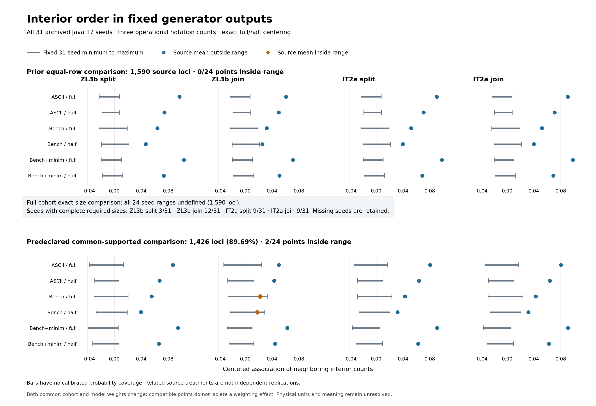

# Fixed generator interior comparisons on one scale



[PNG](generator-interior-comparison/generator-interior-comparison.png) ·
[SVG](generator-interior-comparison/generator-interior-comparison.svg) ·
[Exact plotted values, actual artist coordinates and provenance](generator-interior-comparison/generator-interior-comparison.json)

This figure renders existing results from the
[original interior diagnostic](../SELF_CITATION_INTERIOR.md), PR #137, and the
[exact-size follow-up](../SELF_CITATION_SIZE_CONDITIONED.md), PR #143. It computes
no new manuscript/model measurement, seed sample, permutation control, fitted
parameter or source selection. The four columns retain ZL3b split/join and IT2a
split/join, with three operational count policies and two centering scopes each.
All eight panels share the same x limits. “Full” in the row labels means exact
unrestricted interior-permutation centering; “half” means early/late centering.

- The top row plots all 24 original points and fixed 31-seed ranges on 1,590
  common source loci. No point is inside its range.
- The middle banner preserves all 24 **undefined** full-cohort standardized
  ranges. Complete required-size support exists in only 3, 12, 9 and 9 of the
  31 seeds for the respective variants. Those seeds are not dropped, and missing
  support is not drawn as a zero range or numerical failure.
- The bottom row plots all 24 predeclared common-supported points and source-
  specific standardized ranges on 1,426 loci (89.6855% coverage). The two ZL3b
  join bench-sequence points are inside their ranges; the remaining 22 are above.

Gray segments are the inclusive minimum to maximum of all 31 fixed seed values,
not confidence intervals or calibrated probability coverage. Blue circles mark
source means outside those ranges; amber diamonds mark means inside. The source
cohort and model weights both change in the lower row, so the two inside points
cannot be attributed to weighting alone. Related source/spacing/count policies
are not independent replications. The approximate encoded-row bridge, finite
notation counts, prior exposure and physical/glyph/meaning limits remain as
recorded in the two complete result notes. The figure supplies no decipherment
or copying-family rejection.

## Pinned inputs and independent plotting checks

Both full report byte identities are required before rendering:

| Input | SHA-256 |
| --- | --- |
| Current accepted interior report | `113b4b407691c3765e949de5f8390703bf0fdd94cfa3d6d9a30ed05790ff6829` |
| Current effective exact-size report | `2610917f3946dc757d2d68a5839cb9be64c1d38b2567449c218bc4a1c6ad0522` |

The renderer reads derivative JSON only, without loading manuscript or native
Java artifacts or calling either experiment producer. It verifies complete
ordered seed/variant/policy families, all 48 exact source points and min/max
endpoints against the saved seed values, inclusive memberships and gaps, the
unchanged primary targets, null primary ranges, coverage and complete-size seed
counts. Every plotted point and bar also has its actual Matplotlib artist
coordinates recorded in provenance, rather than only a copy of input values.

Thirteen focused tests pass for these contracts, scalar types, missing seeds/points,
fabricated primary ranges, modified fractions, source denominators, protected
input/output aliases and failed-render behavior. PNG dimensions are **2,720 ×
1,856**. Every actual point/bar coordinate matches its exact source record and
canonical row position; export hashes, SVG text and local-only references are
checked. The PNG was visually inspected for readable labels, shared axes,
unobscured points, correct compatible-point marking and explicit undefinedness.
PNG/SVG/provenance rerender byte-for-byte in the recorded environment.

## Explicit maintenance and first-export preservation

[Figure amendment 1](generator-interior-figure-amendment-1.json) records the
accepted parent serialization repair and the [size transition](../SELF_CITATION_SIZE_AMENDMENT_1.md).
The exact first PNG/SVG/provenance and original renderer text remain in
[hashed inert snapshots](generator-interior-comparison/first/). The original
input fingerprints remain recorded there, rather than silently replacing the
first-run evidence.

The effective renderer uses local decimal chunks instead of changing the
interpreter's global integer conversion guard. Every original rendering/data
function AST is unchanged except the local fraction parser and main transition
guard. All **48** actual artist positions, **72** scientific comparison records,
axis limits, cohort/coverage fields, labels and rendering environment are
identical. Only `input_report_sha256` and `renderer.script_sha256` differ in
provenance. **PNG/SVG bytes remain exactly identical.**

[Completed verification](generator-interior-figure-amendment-1-validation.json)
records 13 focused figure tests and 119 relevant tests, complete byte rerender,
archive/source AST identities and the unchanged global guard. Negative tests
reject changed pixels, coordinates, environment or input identities. These are
post-result maintenance records, with no new data, plotting choices or scientific
outcome. The figure remains stacked on PR #143 until that parent is accepted;
retargeting to main does not itself certify review or a decipherment.

## Reproduce the exports

The recorded renderer uses Python 3.14.3, Matplotlib 3.10.8, NumPy 2.5.4 and
Pillow 12.3.0, with the full dependency versions in
[requirements](../generator-interior-figure-requirements.txt). Font/FreeType,
script and input/export fingerprints are recorded in provenance. Matplotlib is
installed from its [official PyPI release](https://pypi.org/project/matplotlib/3.10.8/).
Exact byte replay requires the recorded dependencies/fonts; another environment
may preserve numeric coordinates while changing rendered bytes or provenance.

```sh
python3 -m pip install -r research/literature/generator-interior-figure-requirements.txt
python3 scripts/plot_generator_interior_comparison.py \
  --check-dir research/literature/figures/generator-interior-comparison
python3 -m unittest tests.test_generator_interior_figure
```

Use `--new-output-dir PATH_TO_NEW_DIRECTORY` to create another export set. The
whole figure renders in memory before a new directory is created. Existing
output directories and protected source/code storage are refused; directory
identity is rechecked after rendering and before exclusive file creation. A
failed render leaves no export directory. The three-file export is not an atomic
transaction; a write failure can leave a partial new directory, which must not
be described as a verified complete export set. No input is overwritten.

Only the generated PNG/SVG, derivative numeric provenance, renderer/tests,
dependency versions and this note are published. Third-party source/output/
configuration/log/ledger payloads and private local paths remain excluded.
