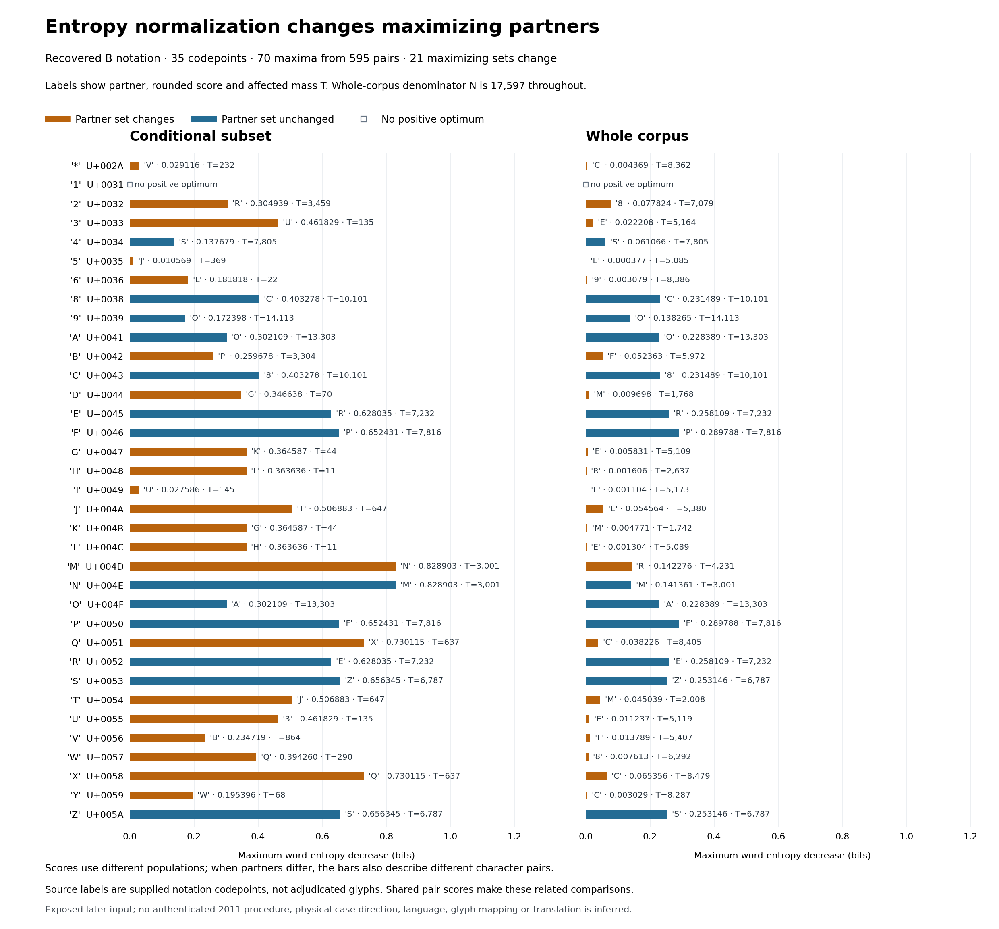

# Every native maximizing partner under both entropy normalizations



[PNG](native-substitution-rankings/native-substitution-rankings.png) ·
[SVG](native-substitution-rankings/native-substitution-rankings.svg) ·
[Complete plotted records, actual bar coordinates and provenance](native-substitution-rankings/native-substitution-rankings.json)

The [accepted native comparison](../NATIVE_SUBSTITUTION_RESULTS.md), PR #158,
retains all 595 character pairs and both normalization definitions. This figure
shows all 70 existing maxima across its 35 supplied codepoints, rather than
only the four paper-associated focus symbols. It reads the derivative report;
no native word file, author program or entropy producer runs.

Both panels use the same zero-based horizontal scale. Labels give the maximizing
partner, its score rounded to six decimals and the pair's affected occurrence
mass `T`. Conditional scores divide by that candidate's `T`; whole-corpus scores
divide by the common `N=17,597`. The exact mass identity applies to the **same
pair**. When partners differ, the two bars describe different pairs as well as
different normalizations, so their displayed quotient is not that identity.

Amber marks the 21 codepoints whose maximizing sets change; blue marks unchanged
positive sets. There are 14 unchanged sets in total, including native `1`, whose
two empty positive sets have gray hollow markers. All 34 zero-score possibilities
for that symbol remain in numeric provenance, with no arbitrary partner or
affected mass selected. Each of the other 68 maxima has one resolved partner;
the accepted report has no positive ties or numerically unresolved maxima.

For `B`, the conditional partner is `P` with `T=3,304`; the whole-corpus partner
is `F` with `T=5,972`. For `V`, the partners are `B` and `F`. The complete figure
also retains every changed and unchanged result outside that fixed focus.
Small affected populations remain visible, without being removed or treated as
evidence of a physical glyph function.

## Frozen inputs and verification

The complete accepted report is pinned to SHA-256
`07ebfc89fc44aefc95aa7dda2d399010ccbd0a7a707c563c9a2bed1954ac453d`.
It preserves the raw-input population of 17,597 occurrences and 3,920 types;
the source identity, original plan, first-result snapshots and post-result parent
transition remain in the complete analysis. This rendering adds no measurement,
cohort, candidate, normalization, precision rule or scientific choice.

The renderer requires all 595 unique pairs, all 70 ordered ranking records and
all 35 comparison records. It checks every recorded maximum, exact prime-signature
tie family, numerical guard outcome, partner set, zero-optimum state and changed
flag against the complete saved pairs. Winner-specific counts come from the
winning pair, not from the opposite panel's winner. All 70 actual Matplotlib bar
widths and row centers are recorded beside the copied rankings and exact decimal
score strings. Coordinates use floating displays of the recorded 80-digit values;
six-decimal labels are approximations.

Nine focused tests verify complete coverage, zero-optimum preservation, exact
winning masses, missing/malformed/scalar-type cases, input pins, failed renders,
existing/protected destinations and late symlink/hardlink/parent redirection.
They also check every actual bar coordinate, export hashes, PNG dimensions and
local-only SVG references. The **2,480 × 2,304** PNG was visually inspected for
unclipped labels, matching row positions, shared scale and explicit zero state.
PNG/SVG/provenance replay is byte-identical in the recorded environment.

## Reproduce

Use the same pinned environment as the accepted generator figure:
[dependency versions](../generator-interior-figure-requirements.txt), Python
3.14.3 and Matplotlib 3.10.8. Provenance includes Python/library/FreeType versions,
the DejaVu Sans fingerprint, renderer source and input/export hashes.

```sh
python3 -m pip install -r research/literature/generator-interior-figure-requirements.txt
python3 scripts/plot_native_substitution_rankings.py \
  --check-dir research/literature/figures/native-substitution-rankings
PYTHONPATH=tests python3 -m unittest test_native_substitution_rankings_figure -v
```

Use `--new-output-dir PATH_TO_NEW_DIRECTORY` for a new export set. Rendering
finishes in memory before directory creation; existing destinations and protected
source/code storage are refused. Directory identity is checked after rendering
and before exclusive file creation. A write failure can leave a partial new
directory; the three-file export is not an atomic transaction. Complete replay
is required before treating it as verified. No input is overwritten.

The exposed later source supplies notation codepoints and whitespace-delimited
word strings, without adjudicated glyphs or lexical meaning. Shared pair scores
make these dependent comparisons. Bars are deterministic descriptive maxima,
without confidence intervals or probability calibration. Historical 2011
preprocessing/procedure, physical case direction, glyph function, language and
translation remain unresolved. This makes the normalization choice inspectable
for future decoding proposals; those still require source-linked prospective
predictions under the [evaluation protocol](../../DECIPHERMENT_PROTOCOL.md).
