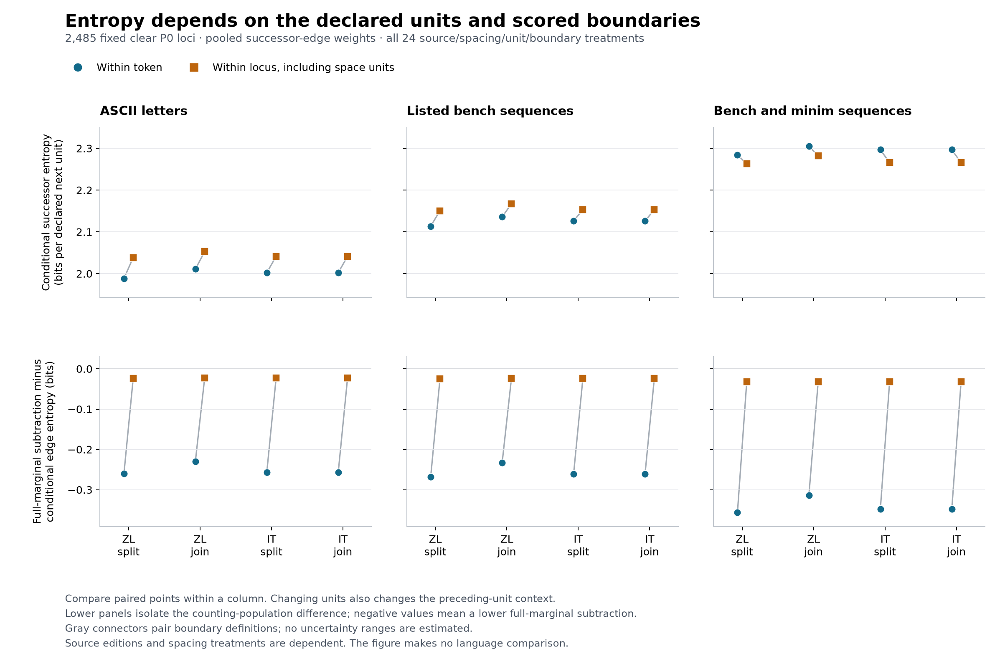

# Paired entropy: units, boundaries and marginal populations



The [accepted report](../paired_symbol_entropy.json) measures the same 2,485
clear P0 loci under two source editions, two spacing treatments, three declared
notation-unit policies and two scored boundary definitions. The figure retains
all 24 treatments from [the method and results](../PAIRED_ENTROPY.md).

The upper panels show empirical conditional successor entropy in bits per
declared next unit. Blue circles score only within native tokens; orange
squares include the declared space units within a locus. Gray connectors pair
these boundary definitions within one source/spacing case. They do not
represent uncertainty ranges.

Each column has a different unit and preceding-unit context. Compare paired
points within a column; the figure does not select a glyph map or rank
languages. Space inclusion raises the displayed ASCII/bench estimates and
lowers the bench/minim estimates in these fixed treatments. Related source
editions and identical IT spacing results remain dependent observations.

The lower panels display `H(edge predecessors) - H(full units)`, equal to
the full-marginal subtraction minus matching-population conditional entropy.
Negative values mark the difference between those two counting populations.
Within-token segments have many separate endpoints, while the locus/space
definition has one per locus. This is the accepted report's named population
shift, rather than a new statistic, error interval or paper-result replication.

## Provenance and reproduction

The renderer requires exact accepted report bytes with SHA-256
`3555bb88a361c4f487cb58bef3045877fa50fc3b1c3ddec2c71ecbaebc5d57b6`.
It verifies complete treatment identities, the shared cohort digest, source
pins, finite plotted values and segment/edge accounting. The
[JSON companion](paired-entropy-sensitivity.json) retains every plotted value,
all treatment identities/denominators, the input identity and renderer version.
There is no recalculation, new filtering or change to the underlying entropy
analysis. A changed report needs explicit figure versioning and review.

PNG and [SVG](paired-entropy-sensitivity.svg) exports use the repository's
pinned plotting requirements, Matplotlib 3.11.2 and DejaVu Sans. SVG generation
dates are omitted and glyph IDs use a fixed salt. All exports regenerate byte
for byte in that environment. The PNG was visually checked for readable
labels, legends and captions without overlaps.

From the repository root:

```sh
python3 -m venv /tmp/voynich-figure-env
/tmp/voynich-figure-env/bin/pip install -r requirements-figures.txt
MPLCONFIGDIR=/tmp/voynich-paired-entropy-mpl /tmp/voynich-figure-env/bin/python scripts/plot_paired_entropy.py
python3 -m unittest tests.test_paired_entropy_figure -v
```

Rendering finishes in memory before guarded artifact writes. Existing input
and cross-artifact aliases are rejected, and paths are rechecked before each
write; this does not claim an atomic filesystem transaction. Tests preserve
the report/source bytes and reject late aliases before any artifact is written.
The source corpus, original analysis inputs and manuscript images are absent
from this contribution's outgoing files.
