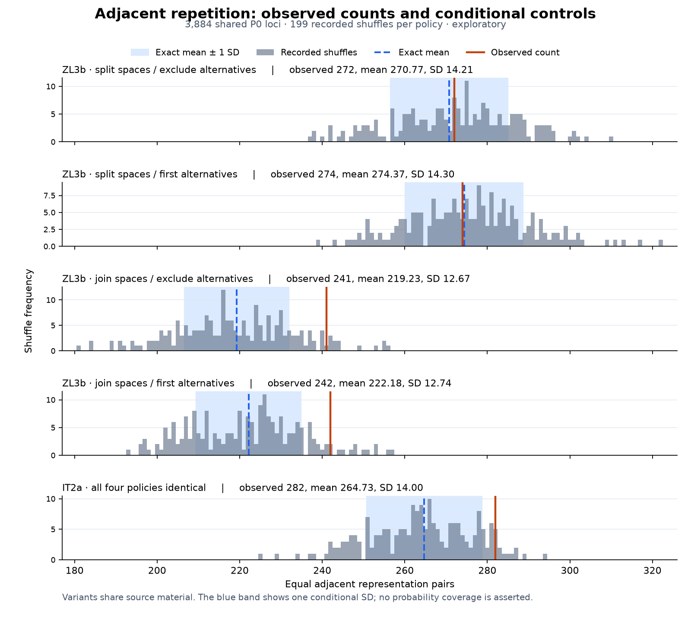

# Exact conditional spread of adjacent repetition

Question: how much spread does the baseline's equal-adjacent-representation count have under its stated token-bag permutation model?

This extends the [exploratory repetition baseline](BASELINES.md) with its exact conditional variance. It uses the same 3,884 shared present `P0` loci, pinned ZL3b/IT2a sources, uncertainty treatments, excluded positions, observed counts, and 199 recorded shuffle results. Existing frequencies, expectations, and shuffle arrays are unchanged. The report method is versioned as v2 to identify the added analytic fields.

## Method and derivation

Within a locus, retain `m` eligible token representations with multiplicities `c_i`. Use the existing adjacency rule to create `e` eligible edges: an excluded source slot cannot create an edge between the surviving tokens on either side. Define `T` as the number of edges whose endpoint representations are equal.

Under a uniform permutation of that locus's token bag, define the falling factorial `(x)_k = x(x-1)...(x-k+1)`. The relevant event probabilities are:

```text
s2  = sum_i (c_i)_2
p2  = s2 / (m)_2
p3  = sum_i (c_i)_3 / (m)_3
p22 = [sum_i (c_i)_4 + s2^2 - sum_i ((c_i)_2)^2] / (m)_4
```

`p2` is equality on one edge. If two distinct edges share one retained position, both equality events require all three representations to agree, giving `p3`. For disjoint edges, the two pairs may have the same representation or two different representations. Those cases give the two terms in `p22`'s numerator. Probabilities requiring more positions than are present are zero and have no corresponding edge pair.

Let `a` count unordered edge pairs sharing one position, and `b` count unordered disjoint edge pairs. For a simple graph, compute `a` by summing `degree × (degree - 1) / 2` over retained positions and set `b = e(e-1)/2 - a`. Then:

```text
E[T]   = e × p2
Var(T) = e × p2 × (1-p2)
         + 2a × (p3-p2^2)
         + 2b × (p22-p2^2)
```

Edge events need not be independent, even when the edges are disjoint: the same finite token bag is being sampled without replacement. Ignoring these covariance terms would generally give the wrong variance.

The declared control model permutes each locus independently. Sum locus variances for the corpus count and take the square root for its conditional standard deviation. The helper uses rational arithmetic for the probabilities and variance; JSON diagnostics are rounded to eight decimal places. This exact spread belongs to the ideal uniform-permutation model, while the 199 recorded pseudo-random shuffles remain its finite simulation.

## Result on the pinned exploratory cohort

| Source | Spaces / alternatives | Observed equal pairs | Exact expected pairs | Exact variance | Conditional SD | Observed minus expected, in SD |
| --- | --- | ---: | ---: | ---: | ---: | ---: |
| ZL3b | split / exclude | 272 | 270.7699 | 201.8628 | 14.2078 | 0.0866 |
| ZL3b | split / first | 274 | 274.3704 | 204.3525 | 14.2952 | -0.0259 |
| ZL3b | join / exclude | 241 | 219.2347 | 160.5558 | 12.6711 | 1.7177 |
| ZL3b | join / first | 242 | 222.1758 | 162.2464 | 12.7376 | 1.5564 |
| IT2a | all four identical | 282 | 264.7307 | 195.9083 | 13.9967 | 1.2338 |

The primary split/exclude treatment is about 0.087 conditional standard deviations above its expected count. Joining uncertain spaces changes that contrast appreciably. This quantifies the preprocessing sensitivity already seen in the baseline. The SD-scaled contrast is a descriptive effect measure; it is not a normal-tail probability, calibrated confidence score, or additional significance test. No normal distribution is assumed. When conditional variance is zero, that contrast is reported as `null` rather than divided by zero.



The figure uses the existing 199 shuffle counts without resampling. The blue band is the exact conditional mean plus or minus one SD, with no asserted probability coverage. IT2a's four policies are collapsed only after their report contents are confirmed identical apart from policy labels. The variants share source material and are not independent replicates. An [SVG version](figures/repetition-variance.svg) and [figure provenance](figures/provenance.json) accompany the PNG.

## Validate and reproduce

Core calculations use only Python's standard library:

```sh
python3 -m unittest discover -s tests -p 'test_repetition_moments.py' -v
python3 -m unittest discover -s tests -p 'test_token_baselines.py' -v
python3 scripts/token_baselines.py --check research/transliteration/token_baselines.json
```

The new helper is `scripts.repetition_moments.conditional_moments(values, edges)`. It accepts eligible token strings and a simple undirected graph on their retained positions, returning rational expected value and variance plus edge-pair counts. Duplicate, self, and out-of-range edges and excluded/non-token values are rejected. The baseline obtains its edges from the existing fixed-gap adjacency function.

Four focused helper tests verify the formula against every unique permutation for several small token bags and every subset of their path edges, including repeated tokens, gaps, empty cases, and non-path graphs. A baseline integration test verifies that independent-locus variances add. The previous 199-count arrays and all previous analytical fields were also compared against the parent report with the new fields removed.

Figure rendering is optional and needs the packages in `requirements-figures.txt`. The recorded renderer used Python 3.14.3 and Matplotlib 3.11.2. In a compatible separate environment:

```sh
python3 -m pip install -r requirements-figures.txt
python3 scripts/plot_repetition_variance.py \
  --report research/transliteration/token_baselines.json \
  --output-dir research/transliteration/figures
```

The renderer records report, script, and output digests and runtime versions. SVG IDs use the report hash and timestamps are omitted. Exact image-byte checks require the matching renderer environment; runtime changes should be recorded rather than silently replacing the figures.

## Limits and next test

All results remain full-cohort exploratory descriptions. Equality refers to preserved transcription representations, not adjudicated manuscript glyphs or decoded words. This control conditions on each locus's token bag and exclusions; it cannot establish a language, cipher, or textual meaning. Loci have not been reconstructed as complete physical lines. The model's independence across loci is a control assumption, not a claim that manuscript writing is independent.

The next analysis should use the reviewed token adapter and a registered positional statistic with its own fixed-gap controls and exposure record. Compare a candidate's stated prediction against the relevant distribution and retain the effect sizes and failed predictions. An observed-versus-shuffled figure cannot substitute for source-linked readings or independent evaluation.
