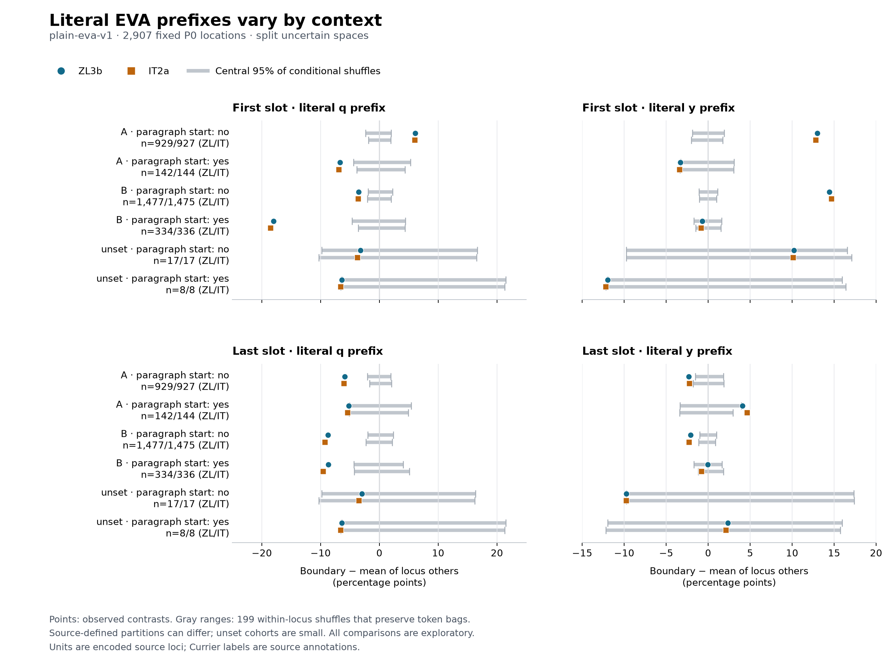

# Conservative prefix figures

These figures display the accepted common-cohort prefix report; they do not
compute a new mechanism test. Both uncertainty-spacing policies and all source
strata are shown. The full [analysis](../CONSERVATIVE_PREFIXES.md) records the
selection, exclusions, source hashes, method, and interpretation limits.

## Split uncertain spaces



- [Vector SVG](conservative-prefixes-split.svg)
- [Plotted values, counts, references, and input digest](conservative-prefixes-split.json)

## Join uncertain spaces


- [Vector SVG](conservative-prefixes-join.svg)
- [Plotted values, counts, references, and input digest](conservative-prefixes-join.json)

## Read the figures

Blue circles and orange squares show observed source-specific contrasts,
expressed in percentage points: boundary prefix rate minus the mean of the
other retained tokens within each locus, averaged with equal locus weights.
Each gray range spans the central 95% of 199 conditional-order shuffle contrasts
for that source, stratum, boundary, and feature. It is a reference distribution
under the stated model, not a confidence interval around the observed point.

The vertical zero line is the exact conditional mean. Rows retain every Currier
label/paragraph-start combination, including sparse unset cohorts. `n=ZL/IT`
gives the source-specific partition sizes; identical global locus keys do not
guarantee identical paragraph assignments. Comparisons share data and remain
exploratory and unadjusted for multiplicity. These are literal encoded prefixes,
not phonetic readings or manuscript glyph identities.

The renderer checks cohort counts/digest, source pins, feature/boundary coverage,
and shuffle reference lengths before plotting. Each JSON companion records the
input-report SHA-256, source hashes, selected-cohort digest, every plotted point,
quantile method, and renderer version. SVG metadata omit a generation date.

## Reproduce

Use the repository's optional pinned plotting dependencies in an isolated
environment. The analysis itself remains standard-library Python.

```sh
python3 -m venv /tmp/voynich-figure-env
/tmp/voynich-figure-env/bin/python -m pip install -r requirements-figure.txt
MPLCONFIGDIR=/tmp/voynich-mpl /tmp/voynich-figure-env/bin/python scripts/plot_conservative_prefixes.py --spacing both
PYTHONPATH=tests python3 -m unittest test_prefix_figure_data -v
```

The recorded render used Python 3.14.3, Matplotlib 3.11.2, and bundled DejaVu Sans.
PNG and SVG layouts were visually inspected. Both use the same source selection
and percentage-point scale; the plotted points and null reference quantiles are
also available without reading values from the image.
