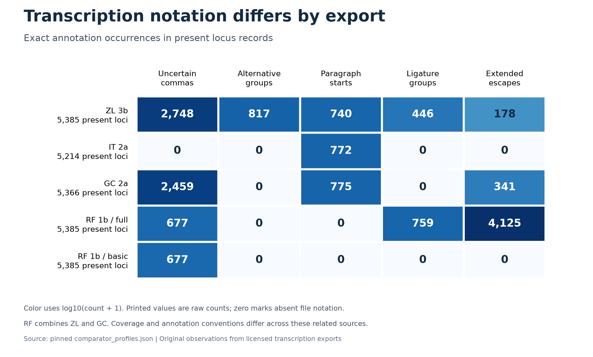

# Transcription annotation figure



The figure shows raw annotation occurrences in **present** locus records from the
[verified comparator profile](../comparator_profiles.json). Counts and column
definitions follow [COMPARATORS.md](../COMPARATORS.md). Colors use
`log10(count + 1)` for legibility; printed values are exact counts. Zero denotes
absent notation in that export. Coverage differs across rows, and RF is derived
from ZL and GC. These are related source representations, not independent samples
or accuracy/decipherment scores.

The full/basic RF exports visibly differ in retained extended escapes and
ligature notation despite identical headers and location coverage. Their absent
paragraph markers require a separately documented segmentation policy. This
figure makes those input-selection constraints visible without changing the
source decision or running a new statistical test.

[SVG vector version](transcription-annotations.svg) and
[provenance / exact count matrix](transcription-annotations.json) are available.
The provenance records source/profile/output hashes and renderer versions.

## Reproduce

Normal research checks remain standard-library only. Figure rendering has its
own pinned optional dependencies:

Use Python 3.14 to match the tested figure environment.

```sh
python3 -m venv /tmp/voynich-figure-env
/tmp/voynich-figure-env/bin/pip install -r requirements-figure.txt
MPLCONFIGDIR=/tmp/voynich-figure-cache /tmp/voynich-figure-env/bin/python scripts/plot_transcription_annotations.py
```

The renderer recomputes the source-byte audit and refuses a profile that differs
before plotting. The committed figure used Python 3.14.3, Matplotlib 3.11.2, and
NumPy 2.5.4; exact output bytes can depend on interpreter or rendering-library
changes. SVG timestamps are omitted and the SVG hash salt is fixed. Compare
the printed-count matrix and input hashes when reproducing under another runtime.

The PNG was visually inspected for legibility, clipping, labels, and agreement
with the underlying matrix. The SVG's XML structure was checked; it contains
font paths exported from the same plot. Source credit and the publisher's CC0
statement are recorded with the [pinned datasets](../../../data/README.md).
