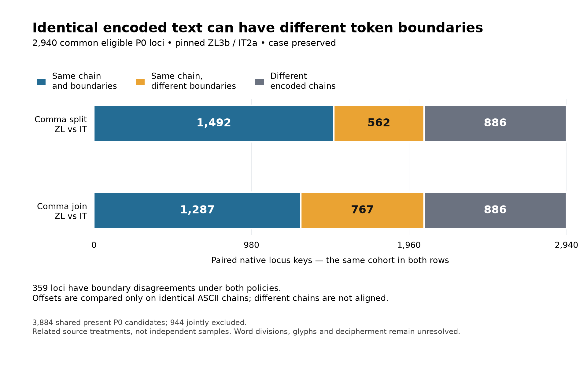

# Encoded-chain and token-boundary agreement



The chart displays the complete cross-source categories from the
[literal-chain boundary report](../TOKEN_BOUNDARY_CONCORDANCE.md), using the same
**2,940 common eligible native P0 loci** under both comma policies. The plotted
unit is a paired native locus key, including same-line fragments and one-token
loci; it is not an independently inspected physical line or linguistic word.

All six count values and the fixed denominator are shown. Blue/orange/gray
categories partition the selected keys. Boundary offsets are compared only
when the concatenated case-preserved ASCII strings agree exactly; different
chains are not aligned. The **886 different-chain keys are identical** across
spacing policies, and the boundary-disagreement sets intersect at **359** loci.
The footer retains the 3,884 shared-present candidate denominator and 944 joint
exclusions. There are no error bars or source-accuracy scores.

The two rows are related treatments of the same editions and manuscript, rather
than independent experiments. Native Eva-/EvaT string agreement does not verify
glyphs or source-image regions. Word divisions and decipherment remain
unresolved. No source corrections, additional statistics, candidate mechanism
or untouched evaluation are introduced.

[SVG](token-boundary-concordance.svg) and
[exact plotted counts/provenance](token-boundary-concordance.json) preserve the
input report/cohort/source hashes, renderer versions and script/output hashes.
The chart contains no source-manuscript pixels or simulated manuscript writing.

## Replay

Normal tests remain standard-library only. Use the project's optional pinned
[figure dependencies](../../../requirements-figures.txt) for rendering:

```sh
python3 -m venv /tmp/voynich-figure-env
/tmp/voynich-figure-env/bin/pip install -r requirements-figures.txt
MPLCONFIGDIR=/tmp/voynich-boundary-plot-cache /tmp/voynich-figure-env/bin/python scripts/plot_token_boundary_concordance.py --check-dir research/transliteration/figures
MPLCONFIGDIR=/tmp/voynich-boundary-plot-cache /tmp/voynich-figure-env/bin/python scripts/plot_token_boundary_concordance.py --output-dir /tmp/voynich-boundary-figure
python3 -m unittest tests.test_token_boundary_figure -v
```

The renderer checks the exact pinned report bytes and recomputes its entire
native-source producer before plotting. It verifies all category key sets as
partitions of the identical selected cohort, the different-chain identity
across policies and the persistent-disagreement intersection. Output guards
run before the producer/renderer. PNG/SVG/JSON are generated in memory, and
`--check-dir` compares all three complete exports.

The tested rendering environment is Python 3.14.3 and Matplotlib 3.11.2. SVG
timestamps are suppressed, its hash salt is fixed, and the font family is
explicit. Different rendering-library versions may change output bytes;
retain the exact count/cohort/source checks rather than silently refreshing
published pins. The 1,920 by 1,200 PNG was visually checked for readable labels,
caption spacing and clipping; SVG references and image metadata were checked
for private paths or external content.

This standalone repository figure is linked from the boundary report.
The [99Tokens Folio](../../../folio/README.md) has a separate publication manifest.
